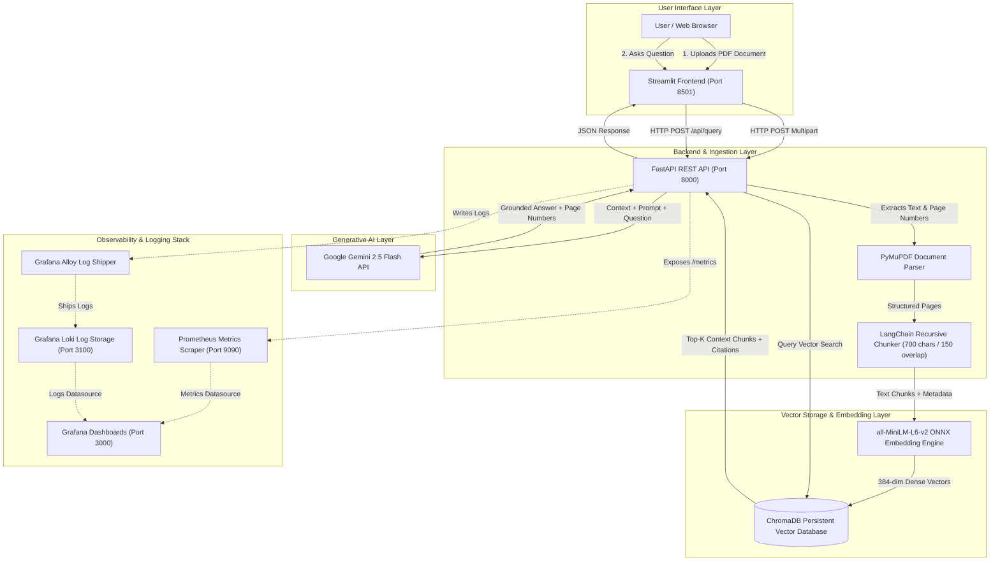
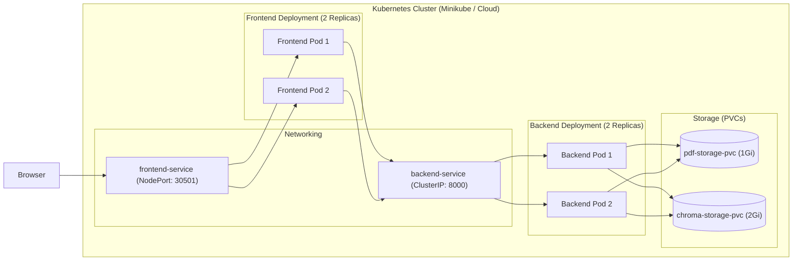

# 🏛️ System Architecture - Mini Enterprise AI Knowledge Assistant

## 1. High-Level Architectural Flowchart

---

## 2. Ingestion Pipeline Breakdown

1. **Upload & Validation:**
   - PDF files uploaded via Streamlit are sent as binary streams to `POST /api/upload-pdf`.
   - The file extension is validated against `.pdf`, and size is checked.
2. **Text Extraction (`backend/pdf_processor.py`):**
   - PyMuPDF opens the PDF in memory.
   - For every page, text and metadata (page number, character counts) are captured.
   - Detects whether the PDF contains extractable text or scanned raster images.
3. **Chunking Strategy:**
   - Uses `RecursiveCharacterTextSplitter` with `chunk_size=700` and `chunk_overlap=150`.
   - Preserves semantic boundary continuity across paragraphs and sentence endings.
   - Every chunk is tagged with its origin file name, page number, and chunk index.
4. **Vector Embedding & Storage:**
   - Chunks are vectorized using the local `all-MiniLM-L6-v2` ONNX model (384-dimensional dense vectors).
   - Embeddings and metadata are indexed in `chroma_db/` with cosine distance space.

---

## 3. Query & Retrieval Pipeline (RAG)

1. **User Query:** User enters a natural language question in the Streamlit UI.
2. **Semantic Similarity Search:** ChromaDB performs approximate nearest neighbor (ANN) search and returns the top $K$ chunks (default: $K=3$).
3. **Context Assembly:** The retrieved text snippets, document names, and page numbers are concatenated into a structured context window.
4. **LLM Synthesis:** The assembled prompt is passed to Google Gemini with strict grounding instructions:
   - Use ONLY the provided document context.
   - Always state the exact page number(s).
   - If the answer is not in the context, clearly decline to hallucinate.
5. **UI Rendering:** Streamlit displays the synthesized response alongside expandable citation cards displaying document source, page number, vector similarity distance, and exact text snippets.

---

## 4. Kubernetes High-Availability Architecture

---

## 5. Security & Reliability Highlights

* **Decoupled Architecture:** Frontend and Backend run as independent services and can scale independently.
* **Resilience:** Liveness and readiness probes guarantee self-healing if a container encounters an unhandled exception.
* **Data Persistence:** Persistent Volume Claims (PVC) prevent data loss during pod restarts or node rescheduling.
* **Zero Vendor Lock-in for Embeddings:** Embeddings run completely locally using open-source ONNX models.
